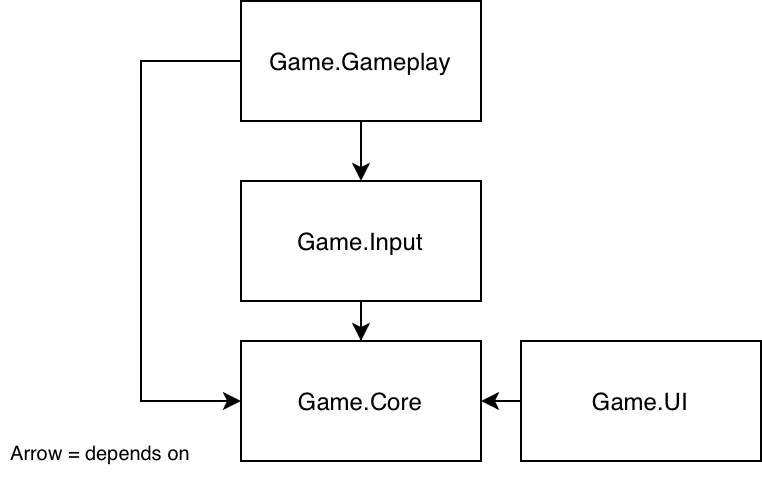
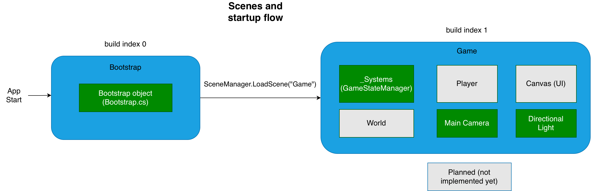
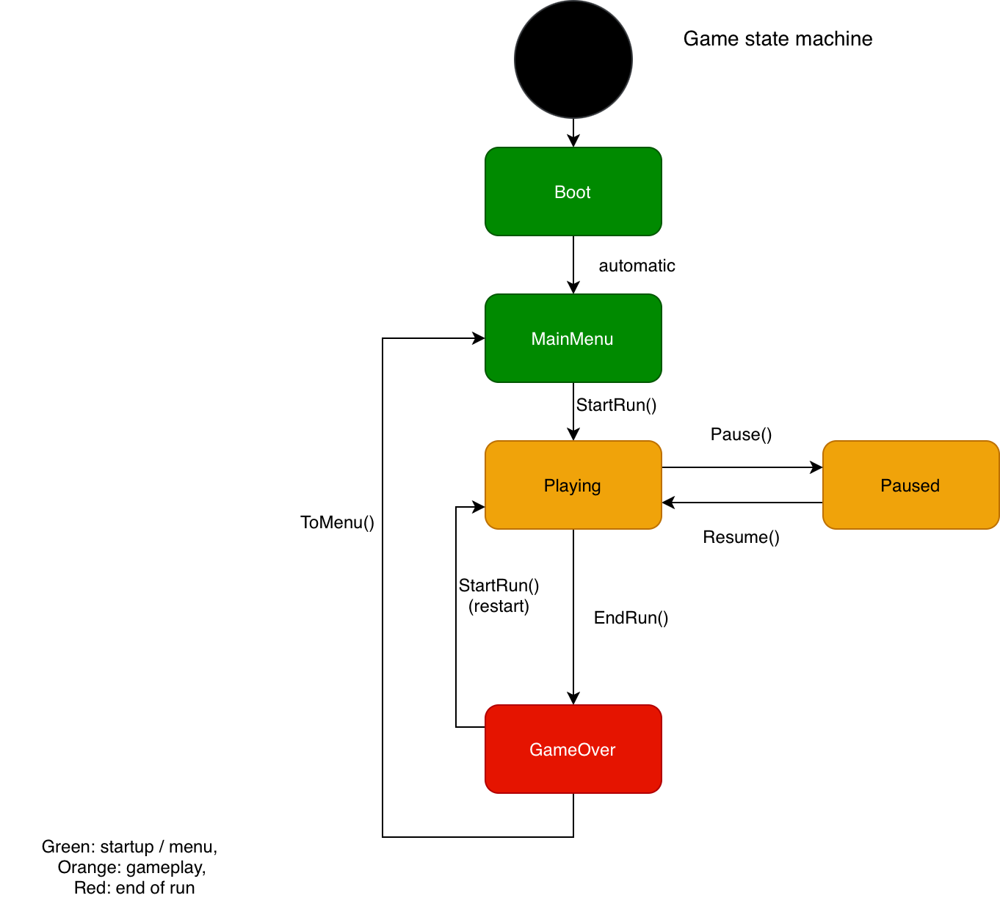
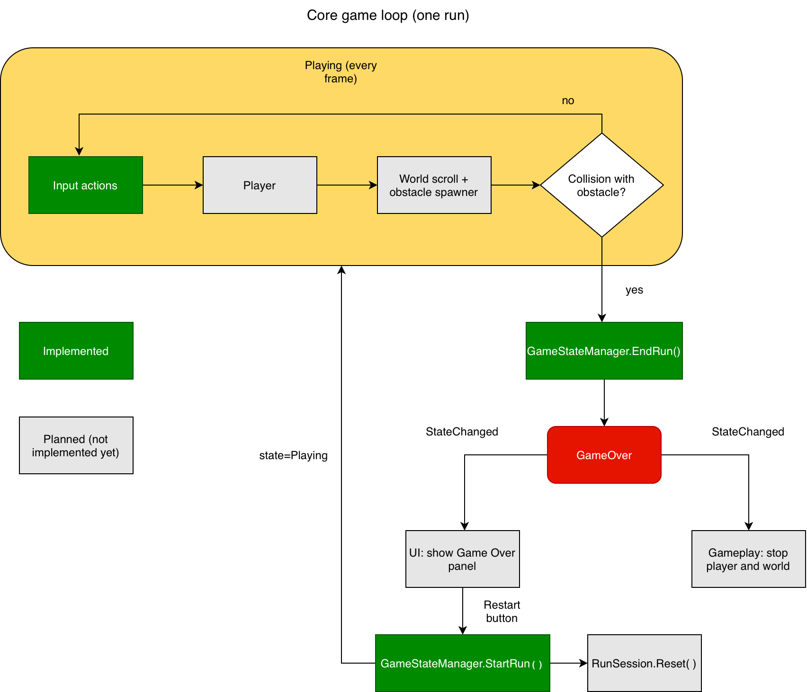

# Architecture

## 1. Overview

The project is a 3D endless runner (in the style of Subway Surfers) built in Unity 6. Target platforms: Android, WebGL (published on itch.io) and Windows. The current stage is a "zero-art" playable core built from primitive meshes.

The architecture is built around three ideas:

1. **Code is split into assemblies** (Assembly Definitions) with strict one-way dependencies.
2. **The whole game is driven by one state machine** (`GameStateManager`). Other systems react to its events instead of calling each other directly.
3. **The player runs forward along Z** (CharacterController) and the camera follows. The track is built from **pooled chunks** that are spawned ahead of the player and recycled behind, so nothing is instantiated or destroyed during a run.

> Status legend used in this document: ✅ implemented, 🔜 planned.

## 2. Project structure

```
Assets/
└── _Project/
    ├── Art/
    │   └── Materials/       (placeholder materials for the track)
    ├── Audio/
    ├── Prefabs/
    │   └── Chunks/          (6 placeholder track chunks)
    ├── Scenes/              (Bootstrap, Game)
    ├── ScriptableObjects/
    ├── Settings/            (Input Actions asset, render pipeline and build profile settings)
    └── Scripts/
        ├── Core/            Game.Core.asmdef
        ├── Input/           Game.Input.asmdef
        ├── Gameplay/        Game.Gameplay.asmdef
        ├── UI/              Game.UI.asmdef
        └── Editor/          Game.Editor.asmdef (editor only)
```

All project-specific assets live under `_Project`, so they are not mixed with third-party assets.

## 3. Assemblies

| Assembly | Responsibility | Depends on |
|---|---|---|
| `Game.Core` | Game state, bootstrap, shared services | nothing |
| `Game.Input` | Wrapper over the Input System (`LaneInput`) | `Game.Core`, `Unity.InputSystem` |
| `Game.Gameplay` | Player movement, track generation | `Game.Core`, `Game.Input` |
| `Game.UI` | Menus, HUD, game over screen (🔜, currently empty) | `Game.Core` |
| `Game.Editor` | Editor tooling: placeholder chunk generator | `Game.Gameplay` |

Rules:

- Dependencies point in one direction only. `Game.Core` never references any other game assembly.
- `Game.UI` and `Game.Gameplay` do not reference each other. They communicate only through `Game.Core` (state and events).
- A script belongs to the assembly of the folder it lives in.
- `Game.Editor` is compiled for the Unity Editor only (`includePlatforms: Editor`), so it is never part of a player build. It is not shown in the diagram below.

Benefits: a change in one assembly recompiles only that assembly and what depends on it, and the compiler rejects accidental circular dependencies.



## 4. Scenes and startup flow

| Scene | Purpose |
|---|---|
| `Bootstrap` | Entry point (build index 0). Contains a single `Bootstrap` object which loads the first gameplay scene. A place for future service initialization (save data, analytics, ads). |
| `Game` | The main scene. Main menu, gameplay and game over are handled here through game states. |

Startup flow:

1. The application starts in `Bootstrap`.
2. `Bootstrap` loads `Game`.
3. `GameStateManager` starts in `Boot` and switches to `MainMenu`.
4. `TrackSpawner` builds the initial track, so the level is visible before the run starts.

Hierarchy of the `Game` scene:

```
Game
├── _Systems         GameStateManager, LaneInput (+ temporary DevAutoStart, DevStats)
├── World            TrackSpawner; pooled track chunks are children of this object
├── Player           CharacterController, PlayerRunner, PlayerLaneMover, PlayerMotor (placeholder capsule)
│   └── Main Camera  (temporary: parented to the player until Follow Camera, 2.1.5)
├── Directional Light
└── Canvas           UI root (🔜 menu, HUD, game over panels)
```



## 5. Game state machine

`GameStateManager` (`Game.Core`) holds the current `GameState` and is the single source of truth for what the game is doing.

States: `Boot`, `MainMenu`, `Playing`, `Paused`, `GameOver`. A `Victory` state (reaching 1000 m) is 🔜 and will be added together with the end states.

| From | To | Triggered by |
|---|---|---|
| (start) | `Boot` | application start |
| `Boot` | `MainMenu` | `GameStateManager.Start()`, automatically |
| `MainMenu` | `Playing` | `StartRun()` |
| `Playing` | `Paused` | `Pause()` |
| `Paused` | `Playing` | `Resume()` |
| `Playing` | `GameOver` | `EndRun()` (player died) |
| `GameOver` | `Playing` | `StartRun()` (restart) |
| `GameOver` | `MainMenu` | `ToMenu()` |

How it works:

- `SetState(next)` does nothing if `next` equals the current state.
- On every change it sets `Time.timeScale` (`0` in `Paused`, `1` otherwise) and raises the event `StateChanged(from, to)`.
- Other systems subscribe in `Start` (or `OnEnable`) and unsubscribe in `OnDestroy` (or `OnDisable`), then react to the new state. A new run is detected as a transition into `Playing` from any state except `Paused`; systems use it to reset themselves.
- The manager is accessed through the `GameStateManager.Instance` singleton. Only one instance may exist.
- `Pause()`/`Resume()` exist, but nothing calls them until the UI is added (🔜).

Why events: the publisher does not know who listens. New systems can be added without modifying the manager, and `Game.UI` and `Game.Gameplay` stay independent of each other.



## 6. Core game loop



While the state is `Playing`, every frame:

1. `LaneInput` reports lane changes and jump requests as events.
2. `PlayerLaneMover` updates the target lane; `PlayerMotor` handles the jump request.
3. `PlayerMotor` moves the player with a single `CharacterController.Move` call (forward, sideways and vertical movement together).
4. `TrackSpawner` recycles chunks left behind the player and fills the track ahead.
5. 🔜 Collisions with obstacles are checked. A hit calls `GameStateManager.EndRun()`, the state becomes `GameOver`, and every system reacts to `StateChanged`: the UI shows the Game Over panel and gameplay stops.

On restart, `StartRun()` returns the game to `Playing`. Systems that detect a new run reset themselves: the player returns to the start position and the center lane, the speed ramp restarts, and the track is rebuilt from the pool.

Items that are not implemented yet (obstacle hit logic, run session data, UI) are shown in grey on the diagram.

### 6.1 Player movement

Movement is split into three small components with one job each. Only `PlayerMotor` changes the player's position.

| Component | Responsibility |
|---|---|
| `PlayerRunner` | Forward speed (starts at 10 units/s, +0.5 every 10 s of survival) and distance travelled. Does not move anything itself. |
| `PlayerLaneMover` | Keeps the target lane (-1, 0, +1; lanes are 3 units apart) and computes the next X position with `Mathf.MoveTowards`, so the player always ends exactly on a lane. Input pressed mid-snap changes the target immediately (optional setting to ignore it). |
| `PlayerMotor` | Combines forward speed, lane X and vertical velocity (jump and gravity) into one `CharacterController.Move` per frame. |

Jump: launch velocity is `sqrt(2 · g · jumpHeight)` with `g = -Physics.gravity.y · gravityScale`. The vertical step uses the average of the old and new velocity (velocity Verlet), so the sampled jump arc follows the parabola regardless of the frame rate. The sampled apex can still be slightly lower than `jumpHeight` at very low frame rates.

Why `CharacterController`: all horizontal movement is scripted (constant forward speed, snapping to lanes), so the game needs collision handling and a ground check, not rigid body physics (pushing, rotation, tunnelling at high speed).

### 6.2 Track generation

The endless track is built from chunks that are pooled with `UnityEngine.Pool.ObjectPool`.

**Chunk contract** (`TrackChunk`, on the root of every chunk prefab):

- The chunk origin is its start edge; the floor spans local Z `0 .. Length` (30 units) and is 10 units wide.
- Lanes are at X = -3, 0 and +3.
- `Difficulty` is 0-3 (0 = empty). Obstacles are pre-placed inside the chunk as trigger colliders, so they are recycled together with the chunk. Hit logic is 🔜.

**`TrackSpawner`** (on `World`):

- Keeps one `ObjectPool` per chunk prefab. Pools are prewarmed at load, so nothing is instantiated during a run.
- Every frame, while `Playing`: first recycles chunks that are more than 30 units behind the player, then spawns chunks until the track extends 120 units ahead. Recycling before filling bounds the number of live chunks.
- Pool size is derived from the worst case: `ceil((despawnBehind + spawnAhead + 2 · maxChunkLength) / minChunkLength) + 1` instances per prefab (8 with the current settings), because the same chunk may be needed several times at once.
- Chunk choice is random among chunks whose difficulty does not exceed the level allowed for the next chunk. The allowed level starts at 0 for the first 2 chunks, then rises by 1 every 250 m up to 3. The same chunk is not picked twice in a row when another eligible chunk exists. Selection uses no lists or LINQ, so it creates no garbage.
- A new run releases all active chunks and rebuilds the track from the start.

**Placeholder chunks** are generated by the editor tool `Tools > Track > Create Sample Chunks` (`Game.Editor`): 6 prefabs built from primitives (every row of obstacles leaves at least one free lane).

## 7. Input

The project uses the Unity **Input System** package (not the legacy `Input` class). `LaneInput` (`Game.Input`) defines its actions in code and exposes two events:

| Event | Keys |
|---|---|
| `LaneChangeRequested(-1 / +1)` | Left: `A` / `←`; Right: `D` / `→` |
| `JumpRequested` | `Space` / `W` / `↑` |

Gameplay code listens to these events and does not care about the input device. 🔜 Input bindings will be moved to the Input Actions asset in `_Project/Settings` (one source of truth, supports rebinding), together with touch swipe controls for Android, a pause action and a slide action.

## 8. Key design decisions

- **The player moves forward, track chunks are pooled and recycled.** This follows the spec (forward on Z). A run is bounded (victory at 1000 m), where float precision is roughly 0.0001 m, so no coordinate rebasing is needed. If runs ever become unbounded, add a floating origin that shifts the player and the world back towards zero once |z| exceeds roughly 5000 m.
- **One motor, `CharacterController`.** A single script moves the player, so scripts do not fight over the transform.
- **State machine plus events** instead of direct references between systems.
- **Assembly definitions** to enforce architecture boundaries and speed up compilation.
- **Bootstrap scene** so that future services are initialized before gameplay starts.
- **Pool sized for the worst case, recycle before fill**, so the live chunk count has a hard upper bound and no instance is created during a run.
- **Frame-rate independent jump arc** (velocity Verlet) instead of simple per-frame integration.
- **Obstacles are trigger colliders**, so the controller is never blocked by them; reactions to a hit belong to the game loop.

## 9. Build and delivery

Work happens on the `dev` branch; a weekly pull request to `main` is reviewed. A GitHub Actions workflow (`.github/workflows/deploy.yml`) runs on pushes to `main`: it builds the WebGL player headlessly with GameCI `unity-builder` and publishes it to itch.io with `butler` (channel `html5`). The API key and Unity license data are stored in GitHub secrets. The deploy job runs only after the build job succeeds.

## 10. Implemented and planned

| Area | Status |
|---|---|
| Folder structure, assemblies | ✅ |
| `GameStateManager` and `StateChanged` event | ✅ |
| `Bootstrap` and `Game` scenes | ✅ |
| WebGL CI/CD to itch.io | ✅ |
| 2.1.1 Auto-forward movement and speed ramp | ✅ |
| 2.1.2 Three-lane snapping and keyboard input | ✅ |
| 2.1.3 Jumping | ✅ |
| 2.1.4 Pooled track chunks | ✅ |
| 2.1.5 Follow camera | 🔜 |
| 2.1.6 Obstacles and hazards (hit logic) | 🔜 |
| 2.1.7 Coins and collectibles | 🔜 |
| 2.1.8 Game loop and end states (including `Victory`) | 🔜 |
| 2.1.9 Scoring / run session data | 🔜 |
| 2.2 Art integration | 🔜 |
| 2.3 Audio integration | 🔜 |
| 2.4 UI implementation | 🔜 |
| Input through the Input Actions asset, touch swipe input | 🔜 |

Temporary code to be removed: `DevAutoStart` (starts a run without UI), `DevStats` (FPS and memory overlay), and the camera parented to the player.
