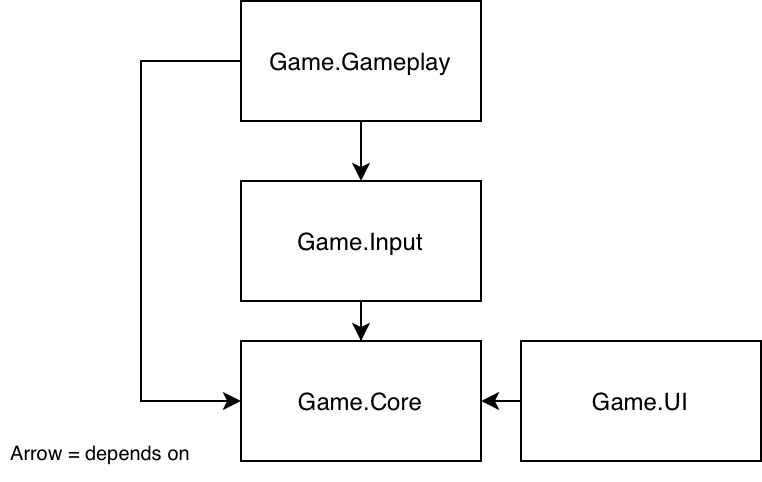
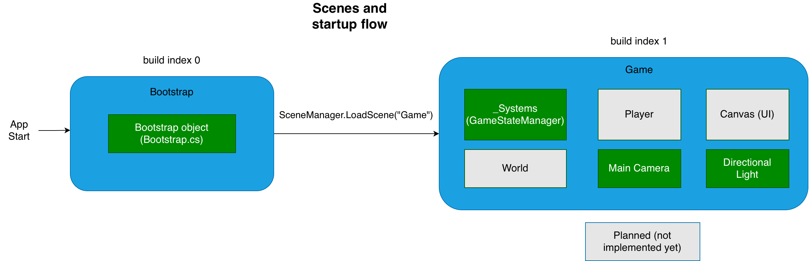
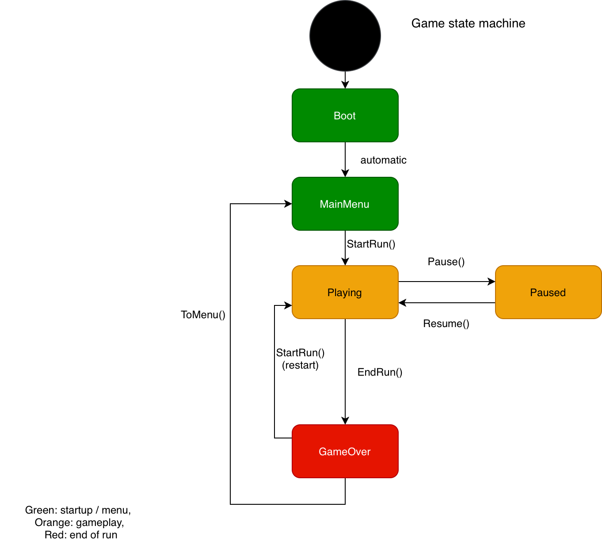

# Architecture

## 1. Overview

The project is a 3D endless runner (in the style of Subway Surfers) built in Unity 6. Target platforms: Android, WebGL (published on itch.io) and Windows.

The architecture is built around three ideas:

1. **Code is split into assemblies** (Assembly Definitions) with strict one-way dependencies.
2. **The whole game is driven by one state machine** (`GameStateManager`). Other systems react to its events instead of calling each other directly.
3. **The world moves towards the player**, not the other way round.

> Status legend used in this document: ✅ implemented, 🔜 planned.

## 2. Project structure

```
Assets/
└── _Project/
    ├── Art/                 (models, materials, textures, animations)
    ├── Audio/
    ├── Prefabs/
    ├── Scenes/              (Bootstrap, Game)
    ├── ScriptableObjects/
    ├── Settings/            (Input Actions asset, render pipeline settings)
    └── Scripts/
        ├── Core/            Game.Core.asmdef
        ├── Input/           Game.Input.asmdef
        ├── Gameplay/        Game.Gameplay.asmdef
        └── UI/              Game.UI.asmdef
```

All project-specific assets live under `_Project`, so they are not mixed with third-party assets.

## 3. Assemblies

| Assembly | Responsibility | Depends on |
|---|---|---|
| `Game.Core` | Game state, bootstrap, shared services | nothing |
| `Game.Input` | Wrapper over the Input System | `Game.Core`, `Unity.InputSystem` |
| `Game.Gameplay` | Player, obstacles, world generation | `Game.Core`, `Game.Input` |
| `Game.UI` | Menus, HUD, game over screen | `Game.Core` |

Rules:

- Dependencies point in one direction only. `Game.Core` never references any other game assembly.
- `Game.UI` and `Game.Gameplay` do not reference each other. They communicate only through `Game.Core` (state and events).
- A script belongs to the assembly of the folder it lives in.

Benefits: a change in one assembly recompiles only that assembly and what depends on it, and the compiler rejects accidental circular dependencies.



## 4. Scenes and startup flow

| Scene | Purpose |
|---|---|
| `Bootstrap` | Entry point (build index 0). Contains a single `Bootstrap` object which loads the first gameplay scene. A place for future service initialization (save data, analytics, ads). |
| `Game` | The main scene. Main menu, gameplay and game over are handled here through game states. |

Startup flow:

1. The application starts in `Bootstrap`.
2. `Bootstrap` loads `Game`.
3. `GameStateManager` starts in `Boot` and switches to `MainMenu`.

Hierarchy of the `Game` scene:

```
Game
├── _Systems         GameStateManager lives here
├── World            parent for generated track segments (🔜)
├── Player           placeholder capsule (🔜 real player)
├── Main Camera
├── Directional Light
└── Canvas           UI root (🔜 menu, HUD, game over panels)
```



## 5. Game state machine

`GameStateManager` (`Game.Core`) holds the current `GameState` and is the single source of truth for what the game is doing.

States: `Boot`, `MainMenu`, `Playing`, `Paused`, `GameOver`.

| From | To | Triggered by |
|---|---|---|
| (start) | `Boot` | application start |
| `Boot` | `MainMenu` | `GameStateManager.Start()`, automatically |
| `MainMenu` | `Playing` | `StartRun()` |
| `Playing` | `Paused` | `Pause()` |
| `Paused` | `Playing` | `Resume()` |
| `Playing` | `GameOver` | `EndRun()` (player died) |
| `GameOver` | `Playing` | `StartRun()` (restart) |
| `GameOver` | `MainMenu` | `ToMenu()` |

How it works:

- `SetState(next)` does nothing if `next` equals the current state.
- On every change it sets `Time.timeScale` (`0` in `Paused`, `1` otherwise) and raises the event `StateChanged(from, to)`.
- Other systems subscribe in `OnEnable` and unsubscribe in `OnDisable`, then react to the new state. For example, the UI shows the matching panel and the player starts or stops running.
- The manager is accessed through the `GameStateManager.Instance` singleton. Only one instance may exist.

Why events: the publisher does not know who listens. New systems can be added without modifying the manager, and `Game.UI` and `Game.Gameplay` stay independent of each other.



## 6. Core game loop

```
MainMenu ──Play──► Playing ──death──► GameOver ──Restart──► Playing
                     ▲  │                 │
                     │  └──Pause──► Paused│
                     └────Resume──────────┘ ──Menu──► MainMenu
```

During `Playing` (🔜): the world scrolls towards the player, the player switches lanes, jumps and slides, obstacles and collectibles are spawned, and run data (distance, speed, score) accumulates in a run session object that is reset when entering `Playing`.

## 7. Input

The project uses the Unity **Input System** package (not the legacy `Input` class). Actions are defined in an Input Actions asset in `_Project/Settings`.

| Action | Purpose |
|---|---|
| `Move` | Lane change (A/D, arrow keys) |
| `Jump` | Jump |
| `Slide` | Slide / crouch |
| `Pause` | Pause the game |

Touch swipe controls for Android are 🔜. They will feed the same actions so gameplay code does not care about the input device.

## 8. Key design decisions

- **World moves towards the player.** The player stays near the origin. This avoids floating-point precision loss at large distances and makes endless generation simpler (segments are recycled behind the camera).
- **State machine plus events** instead of direct references between systems.
- **Assembly definitions** to enforce architecture boundaries and speed up compilation.
- **Bootstrap scene** so that future services are initialized before gameplay starts.

## 9. Build and delivery

A GitHub Actions workflow (`.github/workflows/deploy.yml`) builds the WebGL player headlessly with GameCI `unity-builder` and publishes it to itch.io with `butler` (channel `html5`). The API key and Unity license data are stored in GitHub secrets. The deploy job runs only after the build job succeeds.

## 10. Implemented and planned

| Area | Status |
|---|---|
| Folder structure, assemblies | ✅ |
| Input System package and actions asset | ✅ |
| `GameStateManager` and `StateChanged` event | ✅ |
| `Bootstrap` and `Game` scenes | ✅ |
| WebGL CI/CD to itch.io | ✅ |
| Run session data (distance, speed, score) | 🔜 |
| UI controller reacting to states | 🔜 |
| Player with lane movement | 🔜 |
| World / track generation | 🔜 |
| Touch swipe input | 🔜 |
